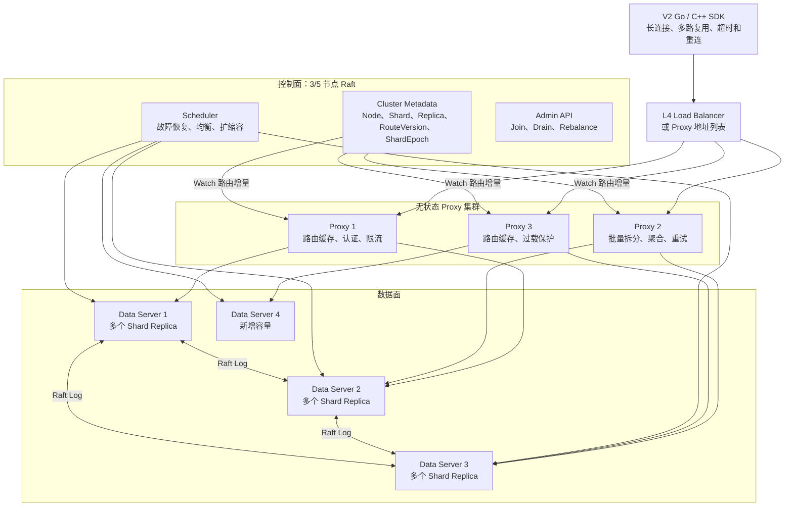

# GoTable 分布式存储产品设计

## 1. 文档信息

- 状态：V2 产品与架构基线
- 目标版本：GoTable Distributed V2
- 适用范围：单 IDC 或同 Region 多可用区部署
- 核心方案：无状态 Proxy、Raft 控制面、分片 Raft 数据节点、LogDB/StateDB RocksDB 状态机

## 2. 背景

当前 GoTable 是基于 Go 和 RocksDB 实现的高性能宽表型 NoSQL 数据库，数据模型为：

```text
Database → Table → RowKey → ColKey → {Value, Score}
```

系统已经具备普通列空间、按 Score 排序的 Z 列空间、CAS、批量操作、SCAN、DUMP、binlog 主从复制和基于 8192 个 slot 的数据迁移能力。

当前主从复制为异步复制，服务拓扑主要由单机配置管理，不具备自动选主、一致性副本、集群级元数据管理、自动故障恢复和在线弹性扩缩容能力。本设计的目标是在保留 GoTable 数据模型和 RocksDB 存储优势的基础上，将其演进为可在多台机器上运行的分布式数据库。

## 3. 产品定位

GoTable Distributed 定位为：

> 面向低延迟、高吞吐业务的分布式宽表/KV 数据库，支持按 RowKey 分片、单分片强一致、多副本高可用和在线弹性扩缩容。

默认通过 Proxy 对外提供服务。客户端只感知 Proxy 地址，不感知 slot、Shard、Replica、Raft Leader、迁移和故障转移等集群内部细节。

### 3.1 产品目标

1. 支持多台 Data Server 共同承载数据和请求。
2. 任意单台机器宕机后自动恢复服务，已确认写入不丢失。
3. 支持在线增加和减少节点，扩缩容期间业务持续读写。
4. 支持副本自动补齐、Leader 自动选举和数据自动均衡。
5. 保持现有 GET、SET、DEL、INCR、SCAN 和 Z 系列数据语义。
6. 提供面向 V2 的 Go/C++ SDK 和新的内部协议；不承诺 V1 协议兼容。
7. 提供可观测、可运维、可限流、可灰度的数据库产品能力。

### 3.2 一期非目标

1. 不实现跨 Shard ACID 事务。
2. 不实现跨 Region 强一致复制。
3. 不实现 SQL 查询和二级索引。
4. 不实现跨 Shard 事务；原子批量写的稳定边界是同一 Slot。
5. 不解决单个超大或超热 RowKey 的自动拆分问题；同一 RowKey 仍固定落在一个 Shard。

## 4. 核心设计原则

1. **Proxy 无状态**：Proxy 可以随时水平扩缩容，不保存无法恢复的业务状态。
2. **控制面不进入数据请求链路**：Proxy 使用本地路由缓存处理请求，不能每次请求同步查询控制面。
3. **Data Server 裁决数据一致性**：路由信息只是提示，Shard Leader、Raft Term 和 ShardEpoch 才是写入合法性的最终判断依据。
4. **每个 Shard 独立共识**：使用 Raft 实现写入排序、多副本提交、自动选主和日志恢复。
5. **端到端幂等**：所有可能被自动重试的写请求必须携带稳定 RequestID。
6. **故障域感知**：同一 Shard 的多个副本应分布在不同机器、机架或可用区。
7. **在线运维优先**：迁移、扩容、缩容和升级均以不中断业务为目标。

## 5. 总体架构



### 5.1 组件职责

| 组件 | 主要职责 |
| --- | --- |
| Client SDK | 连接 Proxy、长连接多路复用、超时、重连、认证、生成 RequestID |
| Proxy | 请求路由、批量拆分与聚合、认证、限流、重试、熔断和可观测性 |
| Control Plane | 集群元数据、节点管理、副本调度、故障恢复、扩缩容和任务编排 |
| Data Server | Shard Replica、Raft、RocksDB、Snapshot、数据读写和副本恢复 |
| Shard Leader | 写入排序、强一致读取、CAS、幂等判断和 Raft 提交 |

## 6. 数据分片设计

### 6.1 Slot 编码与数据模型

保留现有 8192 个 slot 的计算方式：

```text
slotId = CRC32(dbId + tableId + rowKey) % 8192
```

因此同一个 RowKey 的所有普通列和 Z 列都位于同一 slot，可继续支持高效的行内操作和扫描。

### 6.2 Slot 与 Shard Group

不为每个 slot 单独创建一个 Raft Group，避免产生过多 Raft 心跳、日志和调度开销。增加一层 Shard Group：

```text
RowKey → Slot → Shard Group → Replica Set
```

一期默认创建 128 个 Shard Group，每组初始管理约 64 个 slot；也支持初始化时选择 64、128、256 或 512。`Slot → Shard` 由控制面维护，不能长期依赖固定公式，因为后续 Split 可以按容量和热点选择不均匀边界。

每个 Shard Group 默认包含 3 个副本。一个 Data Server 同时承载多个 Shard Replica。

运行中先通过 Replica 搬迁均衡节点；当 Shard 容量、QPS、Snapshot 恢复时间或 Leader 粒度达到阈值时，按任务逐个 Split，使 128 渐进增长到 256/512。在线 Split 在完成基础搬迁和恢复能力后逐步启用，并预留以下演进方向：

- Shard Group 在线拆分和合并。
- 热点 slot 从原 Shard Group 独立迁出。
- 根据磁盘容量、QPS、写入带宽和尾延迟进行综合调度。
- Leader 均衡和 Replica 容量均衡分别执行。

## 7. Proxy 设计

### 7.1 对外入口

Proxy 是产品默认且推荐的唯一数据入口。客户端通过 L4 负载均衡地址或多个 Proxy 地址连接集群，不直接感知 Data Server。

IDC 内增加一层 Proxy 的网络延迟预计不超过 1ms。通过长连接、多路复用、连接池和尽量少的数据复制，将 Proxy 处理开销控制在可接受范围内。

Proxy 应部署至少两个实例，生产环境建议部署三个或更多实例。Proxy 不保存关键业务状态，单个实例故障只影响其已有连接，客户端可自动连接其他实例。

### 7.2 长连接与多路复用

现有 GoTable 协议头已经包含 `Seq uint64` 和包长度，天然支持同一连接上多个并发请求及乱序响应。

每个 Proxy 请求上下文至少包含：

```text
上游连接标识
客户端原始 Seq
ClientID + RequestID + RequestHash
目标 Slot/Shard
RouteVersion + ShardEpoch
Deadline
重试次数和状态
```

Proxy 可以在内部改写 Seq，收到 Data Server 响应后恢复客户端原始 Seq。不同请求不需要按发送顺序返回。

### 7.3 下游连接池

Proxy 到每个 Data Server 维护一个长连接池，而不是只建立一条连接。虽然应用层支持多路复用，TCP 仍可能因为丢包或大响应产生队头阻塞。

建议按流量类型隔离连接：

| 通道 | 请求类型 |
| --- | --- |
| Fast Lane | GET、SET、DEL、INCR、CAS |
| Batch Lane | MGET、MSET、MDEL、MINCR |
| Bulk Lane | SCAN、DUMP 和大响应 |
| Control Lane | 心跳、路由和内部管理请求 |

连接数可以根据活跃请求数、吞吐、发送队列长度和 Data Server 负载动态调整。

### 7.4 请求处理

```text
读取完整协议包
  → 校验协议和包长度
  → 解析 dbId/tableId/rowKey
  → 计算 slot 和 shard
  → 查询内存路由
  → 选择 Leader 或 Follower
  → 检查流控额度和 Deadline
  → 写入下游连接
  → 接收乱序响应
  → 恢复客户端 Seq
  → 返回客户端
```

Proxy 只解析路由和治理所需字段，Value 等 payload 尽量原样转发，减少重复编解码和内存复制。

### 7.5 反压与过载保护

Proxy 的主要延迟风险不是 IDC 内的网络转发，而是高负载下的排队和尾延迟放大。必须实现：

- 每个 Data Server 的最大 in-flight 请求数。
- 每个 Shard 的队列长度上限。
- 上游连接级和租户级限流。
- Fast、Batch 和 Bulk 请求隔离。
- Deadline 已经过期的请求不再发送到下游。
- Data Server 过载时快速返回 `OVERLOADED`。
- 有界 goroutine、有界 channel 和有界内存。
- 下游熔断、半开探测和恢复。

### 7.6 批量请求

Proxy 对 MGET 等批量请求按 Shard 拆分，并行发送后按客户端原始顺序聚合结果。

```text
MGET
  ├── Shard A 子请求
  ├── Shard B 子请求
  └── Shard C 子请求
        ↓
     合并响应
```

批量写语义定义为：

- 同一 Slot 内的批量写原子提交，一个 Raft 命令完成全有全无 Apply。
- 跨 Slot 批量写不保证整体原子，Proxy 返回每个子请求的 `success/failed/unknown`。
- 不因当前多个 Slot 恰好属于同一 Shard 而扩大原子承诺。
- 不使用 Proxy 补偿来伪装跨 Shard 事务。
- 跨 Shard MGET 按 Key 分别保证 `linearizable`（或显式 `stale`），不保证全局同一时间点。
- 普通 SCAN/ZSCAN 允许页间漂移；需要固定边界时使用独立的 Snapshot Scan/Export。

## 8. 控制面设计

### 8.1 高可用元数据

控制面由 3 或 5 个节点组成一个独立 Raft Group，保存：

- Cluster ID 和集群版本。
- Node ID、地址、状态和故障域。
- Slot 到 Shard Group 的映射。
- Shard Group 的期望副本列表和期望副本数。
- Shard Raft 已提交的 Actual ConfState 和观察状态。
- Leader Hint。
- RouteVersion 和 ShardEpoch。
- 节点容量、磁盘水位、QPS 和维护状态。
- 调度任务、执行步骤和任务状态。

控制面可以与 Data Server 同进程部署，但其 Raft Group、存储和生命周期必须在逻辑上独立。

### 8.2 路由发布

Proxy 启动时拉取完整路由快照，之后通过 Watch 长连接接收增量变更：

```text
Full Route Snapshot + RouteVersion
                ↓
Route Change Events
```

普通请求只查询 Proxy 本地内存路由，不能同步访问控制面。

控制面短暂不可用时：

- Proxy 使用已有路由继续服务。
- Data Server 的 Raft 选举继续进行。
- 暂停新的扩缩容、均衡和副本变更。
- Proxy 通过 Data Server 返回的错误修正临时 Leader Hint。

### 8.3 Data Server 管理

Data Server 与控制面保持心跳并上报：

- 节点存活状态。
- 磁盘容量和水位。
- 每个 Shard 的角色、Term、Commit Index 和 Apply Index。
- Snapshot 和副本恢复进度。
- QPS、延迟、错误率和热点信息。

控制面向 Data Server 下发创建副本、加入 Learner、提升 Voter、转移 Leader、删除副本和节点维护等任务。

控制面维护 Desired Membership，Shard Raft 已提交的 ConfState 是 Actual Membership 的最终事实。成员变更必须通过 Learner、Snapshot、Catch-up 和 Raft Membership Change 完成，控制面不能直接覆盖实际配置。

所有调度任务必须持久化、可重入和可恢复。控制面 Leader 切换后能够继续执行未完成任务。

## 9. 一致性与复制

### 9.1 一致性模型

系统采用 CP 模型。每个 Shard 使用独立 Raft Group，默认 3 副本。只要多数副本存活，该 Shard 就可以继续读写；失去多数副本时停止强一致读写，避免脑裂。

### 9.2 写入流程

现有“先写 RocksDB、再异步写 binlog”的流程不能作为自动高可用的基础。新写入流程为：

```text
Client 写请求
  → Proxy
  → Shard Leader
  → 追加 Raft Log
  → 多数副本持久化
  → Raft Commit
  → 各副本按序 Apply 到 RocksDB
  → Leader 返回结果
  → Proxy 返回 Client
```

只有满足“Raft 日志多数副本 durable、Raft Commit、Leader 本地 StateDB Apply 成功”后才能向客户端确认成功。业务数据、Revision、Dedup 和 `lastApplied` 必须在同一个 StateDB WriteBatch 中原子更新，由此保证已确认写入在单节点宕机后不丢失。

同一 Slot 的批量写使用一个 Raft 命令和一个 WriteBatch；跨 Slot 请求由 Proxy 拆分，不提供整体原子性。ZSET、ZDEL 和 ZINCR 维护的两套索引仍在状态机 Apply 阶段使用同一个 WriteBatch 原子更新。

### 9.3 读一致性

提供两种读取级别：

| 级别 | 行为 |
| --- | --- |
| `linearizable` | 默认，从 Leader 读取，通过 ReadIndex 或安全 Leader Lease 保证线性一致 |
| `stale` | 可以从任意健康 Follower 读取，可能返回旧数据 |

失去 Raft 多数派时停止写入和 `linearizable` 读取；只有客户端显式选择 `stale` 才允许继续读取。

### 9.4 Leader 切换

1. Raft 心跳超时后，剩余多数副本选举新 Leader。
2. Proxy 使用旧 Leader 路由发送请求时，Data Server 返回 `NOT_LEADER`。
3. 响应尽可能携带新 Leader Hint。
4. Proxy 更新临时缓存并使用相同 RequestID 重试。
5. 控制面随后发布正式路由更新。

控制面中的 Leader 地址仅作为路由提示，不能作为 Leader 身份的最终证明。

## 10. CAS 和请求幂等

### 10.1 持久化 Revision

当前 CAS token 为节点内存中的短期状态，Leader 切换后无法保持一致。分布式版本中，每条记录需要持久化 64 位 revision，并由 Shard 状态机维护单调递增 Revision Clock；Revision 不直接等同于 Raft Index。

GET 返回：

```text
Value + Score + Revision
```

SET、DEL 和 INCR 可以携带 expected revision。`expected_revision=0` 表示 Create-if-absent，非零值要求当前 Revision 相等。CAS 比较必须发生在 Raft 状态机 Apply 阶段，保证所有副本得到相同结果。成功改变记录才推进 Revision；CAS 失败、无效请求和删除不存在记录不推进。

### 10.2 幂等写入

客户端超时、Proxy 重连或 Leader 切换时，写请求可能处于“已经提交但响应丢失”的状态。每个写请求必须携带：

```text
ClientID + RequestID + RequestHash + Deadline
```

Shard 状态机保存最近一段时间的请求结果。默认逻辑 Deadline 为 30 秒，最大 3 分钟；Dedup 至少保留到 Deadline 后再加安全余量。重复且 RequestHash 相同的请求直接返回原结果，RequestID 冲突返回错误，过期请求不再执行。该机制对 INCR、ZINCR、CAS 和批量写尤其重要。

## 11. 路由版本和 ShardEpoch

只保留两个需要跨组件理解的版本：

- `RouteVersion`：控制面发布路由缓存和 Watch 增量的全局版本。
- `ShardEpoch`：每个 Shard 的 Slot 所有权/边界版本，仅在 Split、Merge 或边界改变时递增。

Raft 直接使用原生 Term、Index 和 ConfState，不再抽象新的产品版本；Snapshot 安装使用仅 Data Server 内部可见的 InstallID。

Proxy 向 Data Server 发送内部 RPC 时携带 RouteVersion 和 ShardEpoch：

```text
请求 ShardEpoch < 当前 ShardEpoch
    → STALE_EPOCH / SHARD_MOVED
    → Proxy 刷新路由并使用原 RequestID 重试
```

Leader 切换只改变 Raft Term，不必改变 ShardEpoch。副本搬迁只改变 Raft ConfState；只有 Proxy 必须感知的节点/路由变化才发布新的 RouteVersion。

建议内部协议增加以下错误码：

- `NOT_LEADER`
- `STALE_EPOCH`
- `SHARD_MOVED`
- `SHARD_NOT_READY`
- `OVERLOADED`
- `TRY_AGAIN`
- `DEADLINE_EXCEEDED`
- `REQUEST_ID_CONFLICT`（相同 RequestID 但 RequestHash 不同）

## 12. 存储布局与 Snapshot

### 12.1 LogDB 与 StateDB

每个 Data Server 默认维护一个 LogDB RocksDB 和一个 StateDB RocksDB：

- **LogDB**：保存各 Raft Group 的 Entry、Term、Index、HardState 和 Snapshot Metadata；可按 Group 使用 Column Family 或 Prefix 隔离。
- **StateDB**：保存业务 KV、Z 双索引、64 位 Revision、Dedup 和 `lastApplied`；每个 Shard Replica 使用一个带 `Incarnation/InstallID` 的 Column Family，另设元数据 CF 保存 Active 映射与 Install Journal。

该布局避免为每个 Raft Group 创建独立数据库，同时保留按 Shard Replica 文件级导出、导入和隔离损坏副本的能力。`Incarnation/InstallID` 只用于 Data Server 内部，防止旧副本在重建后误用旧状态。

### 12.2 B+ 文件级 Snapshot（默认）

副本补齐优先采用 Column Family Export/Import：

1. 发送端在 ApplyGate 下确定状态边界 `N=lastApplied`，导出目标 Shard Replica CF。
2. Export 文件包含业务数据、Revision、Dedup 和 `lastApplied=N`；Manifest 绑定 `ShardID/Generation`、`lastIncludedIndex/Term`、`ConfState`、Schema/编码/Comparator 版本、文件范围和校验和。
3. 接收端导入唯一的新 CF，校验文件和 Manifest 后标记为 hidden state。
4. 持久化 LogDB Snapshot Metadata，再以原子 Active CF Mapping 切换；随后从 `N+1` 追赶 Raft Log。

ApplyGate、Install Journal 和幂等 InstallID 处理 LogDB 与 StateDB 无跨库事务时的崩溃窗口：切换前失败只清理 staging；切换后只允许继续追日志和清理旧 CF。

### 12.3 共享 Prefix 备选路径

若 CF 密度压测不达标，可采用共享 CF + Prefix/Generation。该方案没有任意 Prefix 的零扫描导出能力，Snapshot 必须在逻辑快照边界上顺序扫描 Shard 范围，通过 `SstFileWriter` 重建隐藏 Generation，校验后原子切换并从 `N+1` 追日志。它以迁移时扫描换取更低的稳态 CF/RSS 开销，仅在 B+ 方案无法满足密度或尾延迟目标时启用。

## 13. 故障恢复

### 13.1 Leader 故障

Raft 自动选举新 Leader。Proxy 通过 `NOT_LEADER` 快速修正路由，不依赖控制面完成全局更新后才恢复请求。

### 13.2 Follower 故障

短时故障由 Raft Log 增量追赶。节点恢复后必须以 Follower 身份重新加入，不能使用本地旧状态直接恢复 Leader 身份。

### 13.3 节点永久损坏

1. 控制面确认节点长期离线。
2. 在健康节点创建 Learner 副本。
3. 通过 B+ CF Export/Import Snapshot（共享 Prefix 方案则使用逻辑快照扫描 + SST）传输基础数据。
4. Learner 通过 Raft Log 增量追赶。
5. 追平后提升为 Voter。
6. 从 Raft 成员配置中删除失效副本。

副本调度必须遵守机器、机架和可用区反亲和策略。

### 13.4 控制面故障

只要控制面多数节点存活，就能自动选举并继续调度。控制面暂时不可用时，Proxy 使用缓存路由、健康 Shard 和 Raft 继续服务；拓扑变更、扩缩容和自动调度暂停。数据 Shard 失去多数派时停止写入和线性一致读，只有显式 `stale` 读可继续。Unsafe Recover 必须人工确认并永久 fencing 旧副本。

### 13.5 Proxy 故障

Proxy 无状态，故障后由客户端重连其他 Proxy。写请求使用稳定的 ClientID/RequestID/RequestHash 安全重试，并将 `success/failed/unknown` 结果明确返回。

## 14. 在线扩缩容

### 14.1 扩容与 Replica 搬迁

```text
新节点 Join
  → 控制面注册并检查版本/容量
  → 选择待迁移 Shard Replica
  → 新节点以 Learner 加入
  → 传输 Snapshot
  → 增量追赶 Raft Log
  → 提升为 Voter
  → 必要时转移 Leader
  → 删除旧节点多余副本
```

扩容应同时考虑容量均衡和 Leader 负载均衡。成员变更一次只提交一个 Raft 配置变更；Learner 未完成 Snapshot、校验和日志追赶不得 Promote。Snapshot 传输、Apply、Compaction 和 Bulk 网络必须按节点磁盘、带宽、并发和临时空间预算限速；超过日志保留预算时取消任务并从更新 Index 重新制作 Snapshot。

### 14.2 缩容与 Drain

缩容通过 Drain 完成：

1. 节点进入 `DRAINING` 状态，不再接收新的 Shard。
2. 将该节点上的 Leader 转移到其他健康副本。
3. 为其 Replica 在其他节点创建替代副本。
4. 新副本追平并加入 Raft 配置。
5. 删除待缩容节点上的 Replica。
6. 节点无任何 Replica 后进入 `DRAINED`，允许安全下线。

缩容过程中不能让任何 Shard 的健康副本数低于安全阈值。

### 14.3 Shard 拆分

Replica 搬迁不改变 Shard 边界；当容量、QPS、Snapshot 恢复时间或 Leader 均衡粒度超过阈值时，按任务逐个 Split。初始 128 Shard 通过 Split 渐进扩展到 256/512，不做瞬时全局重分片。在线拆分状态机为：

```text
PLANNED → CHILD_BOOTSTRAPPING → SNAPSHOT_COPYING → CATCHING_UP
        → FENCED → CUTOVER → CLEANING → SUCCEEDED
```

Parent 在 Fence Index `B` 后停止迁移范围的新写，Child 追平到 `B`，控制面原子发布新的 Slot→Shard 路由。CUTOVER 前允许回滚；CUTOVER 后不回切路由，只继续修复和清理。Parent 通过 Raft 驱动 `FinalizeSplit`，再执行 DeleteRange、Flush 和限速 Compaction。旧 Epoch 请求必须被 Data Server 拒绝或重定向。

## 15. 协议与客户端演进

### 15.1 外部协议

V2 对外使用新协议，不承诺 V1 兼容。Go/C++ SDK 只配置多个 Proxy 地址，负责长连接多路复用、超时、重连、稳定 ClientID/RequestID/RequestHash 生成以及 `success/failed/unknown` 结果分类，不感知 Shard、Replica、Raft Term 或 InstallID。

### 15.2 内部协议 V2

Proxy 与 Data Server 之间的协议增加：

- Cluster ID。
- Shard ID。
- ShardEpoch。
- RouteVersion。
- Client ID 和 Request ID。
- Deadline。
- Consistency Level。
- Leader Hint。
- 过载和可重试错误分类。
- 64 位 Revision。

内部 RPC 必须携带 RouteVersion、ShardEpoch、Deadline 和幂等上下文；Data Server 负责最终 Epoch/Leader 校验。协议错误需区分不可重试、可安全重试和结果未知。

## 16. 安全设计

- 客户端只访问 Proxy，Data Server 端口默认仅在集群内部开放。
- Proxy 负责用户认证、Database/Table 权限和租户限流。
- Proxy 到 Data Server 使用节点身份认证。
- 管理接口和数据接口使用不同端口及权限体系。
- 支持 TLS，长连接可以摊薄握手成本。
- 所有集群变更记录审计日志。
- Data Server 仍需验证租户、Shard 和 Epoch，不能完全信任 Proxy 路由。

## 17. 可观测性与运维

### 17.1 核心指标

Proxy：

- 请求量、成功率、P50/P95/P99/P999 延迟。
- Proxy 处理时间、排队时间和下游时间。
- 每条下游连接的 in-flight 和发送队列长度。
- 路由刷新、重试、`NOT_LEADER` 和 `STALE_EPOCH` 次数。
- 限流、熔断和过载拒绝次数。

Data Server：

- 每个 Shard 的角色、Term、Commit Index 和 Apply Index。
- Raft Commit 延迟和 Follower 落后量。
- RocksDB 读写延迟、Compaction、Block Cache 和磁盘水位。
- Snapshot 生成、传输和恢复进度。
- 热点 RowKey、slot 和 Shard。

控制面：

- 节点和 Shard 健康状态。
- 副本不足数量。
- 调度任务数量、状态和耗时。
- Leader 分布和容量偏差。

### 17.2 管理能力

调度任务统一使用持久化 `OperationID`，优先级固定为：故障修复 > Replica 搬迁 > Shard Split > 备份。所有 Bulk 任务支持限速、暂停、恢复、取消和重试，并受节点磁盘、网络、并发和临时空间预算约束。

至少提供以下管理命令或 API：

```text
cluster bootstrap
cluster status
node join
node list
node drain
node remove
shard list
shard describe
shard transfer-leader
cluster rebalance
task list
task describe
```

## 18. 备份和灾难恢复

Raft 解决的是在线副本高可用，不能替代独立备份。系统仍需提供：

- Shard 一致性 Snapshot。
- 集群级备份清单和版本。
- Snapshot 上传对象存储。
- Raft Log 或变更日志归档（用于校验和后续能力演进）。
- 每个 Shard 独立一致，V2 首期不承诺跨 Shard 全局同一时间点，也不承诺 PITR。
- 定期恢复演练和备份完整性校验，恢复失败不得影响 Active Replica。

## 19. 现有代码改造范围

### 19.1 可复用部分

- Database、Table、RowKey、ColKey 数据模型。
- 普通列空间和 Z 排序列空间。
- RocksDB key/value 编码思路。
- 8192 slot hash 算法。
- GET、SET、DEL、INCR、SCAN 和 Z 系列 API。
- Go/C++ 客户端上层接口。
- DUMP、Iterator 和 slot 遍历能力。

### 19.2 需要重构或替换

- 异步 binlog 主从复制替换为 Raft Log。
- `SLAVEOF` 和 MasterConfig 替换为控制面副本管理。
- 现有 slot migration 替换为 Learner、Snapshot 和 Raft Membership Change。
- 内存 CAS 替换为持久化 64 位 revision。
- Server 增加 Shard 状态机、Leader 和 Epoch 校验。
- 客户端默认连接 Proxy，不再直连单个 Data Server。
- 批量操作增加按 Shard 拆分及明确的跨 Shard 语义。
- 存储层增加 Snapshot、日志压缩和崩溃恢复接口。

## 20. 实施路线

### 阶段 0：语义和接口冻结

- 明确一致性级别和跨 Shard 批量语义。
- 定义 Shard、Replica、Epoch、RequestID 和 Revision。
- 定义内部协议 V2 和错误码。
- 建立故障模型和验收指标。

### 阶段 1：一致性内核

- 抽象单 Shard 状态机。
- 接入单 Shard 三副本 Raft。
- 实现 Raft Commit 后 Apply RocksDB。
- 实现持久化 Revision 和幂等 RequestID。
- 实现 Snapshot、日志压缩、节点重启恢复。
- 通过进程崩溃、断网和磁盘故障注入验证正确性。

### 阶段 2：控制面基础与路由

- 实现控制面 Raft、Cluster Metadata、RouteVersion 和 ShardEpoch。
- 实现节点注册、心跳、故障检测和权威 Slot→Shard 路由 Watch。
- 实现最小调度任务模型和 Desired Membership/Actual ConfState 对账。

### 阶段 3：Proxy 和自动高可用

- 实现无状态 Proxy、长连接多路复用和下游连接池。
- 实现路由缓存、Leader 重定向、Epoch 校验和批量请求拆分聚合。
- 实现副本补齐、Leader/Follower/永久节点故障恢复和故障域感知放置。

### 阶段 4：在线扩缩容

- 实现 Learner 和在线 Snapshot 传输。
- 实现 Replica 搬迁、Leader 转移和 Node Drain。
- 实现容量均衡、Leader 均衡和迁移限速。
- 实现 Split 状态机、Fence/Cutover、旧数据清理和滚动升级 Feature Gate。

### 阶段 5：产品化

- 完成监控、告警、Tracing 和审计。
- 完成备份恢复和恢复演练。
- 完成容量模型、压测和故障演练。
- 根据实际负载完善热点治理和多可用区能力。

## 21. 验收目标

一期完成的核心判断标准：

1. RF=3 且副本跨故障域时，任意单个 Data Server 宕机，已确认写入 RPO=0。
2. Shard Leader 宕机后自动选举，恢复请求 P99 ≤ 5 秒，无需人工执行 `SLAVEOF`。
3. Proxy 单实例宕机后，客户端可以自动重连其他 Proxy；Proxy 额外 IDC 内 P99 延迟 ≤ 1ms。
4. 控制面暂时不可用不影响已有缓存路由和健康 Shard；拓扑变更与调度暂停。
5. 新增 Data Server 后，系统可以在线迁移 Replica 和均衡 Leader，且不降低任何 Shard 的安全副本数。
6. Node Drain 完成后可以安全下线节点，期间正常请求持续服务。
7. 网络超时和 Leader 切换期间，INCR 等非幂等业务操作不会重复执行；相同 RequestID 重试返回首次结果。
8. 同一 Slot 批量写全有全无；跨 Slot 批量返回逐项 `success/failed/unknown`，不提供跨 Shard 事务。
9. 旧 ShardEpoch 请求无法写入已迁移或已变更配置的 Shard；失去多数派时不产生新的 Commit。
10. Snapshot、Apply、重启恢复和 Split 不重复、不跳过日志，且不会使在线请求出现不可接受的延迟抖动。

## 22. 关键风险

| 风险 | 应对措施 |
| --- | --- |
| Multi-Raft 调度和心跳开销过大 | 控制初始 Shard 数量，统一 Tick/IO 调度，压测后再调整 |
| Proxy 高负载下排队放大尾延迟 | 有界队列、分级连接、反压、限流和快速失败 |
| 写超时导致重复执行 | ClientID + RequestID 端到端幂等 |
| Snapshot 和 Compaction 抢占 IO | 限速、优先级隔离、磁盘水位保护 |
| Shard/CF 密度导致 RSS 或打开时间过高 | 默认 128 Shard；对 256/512/1024 Shard 压测 B+ CF，必要时退回共享 Prefix/Generation |
| Leader 频繁切换 | 合理选举参数、Leader Transfer、慢节点检测 |
| 路由更新滞后 | Data Server Epoch 校验、Leader Hint 和 Proxy 快速刷新 |
| 跨 Shard 批量语义不清 | API 明确逐项结果和非原子语义 |
| LogDB 与 StateDB 跨库崩溃窗口 | 持久化 lastApplied、ApplyGate、Install Journal 和恢复对账；Apply 失败不跳过日志 |
| 热点 RowKey 无法拆分 | 暴露热点指标，先由业务拆 Key，后续评估行内分区 |

## 23. 结论

GoTable 分布式版本采用以下默认产品架构：

```text
轻量 Client SDK
    ↓ 长连接多路复用
无状态 Proxy 集群
    ↓ 路由缓存、连接池、批量聚合、限流和幂等重试
分片 Raft Data Server 集群
    ↕
高可用 Raft Control Plane
```

Proxy 屏蔽集群底层细节，控制面负责元数据和调度，Data Server 通过 Raft 保证数据一致性和故障恢复。基于现有 8192 slot 建立 Shard Group，可以在保持当前数据模型兼容性的同时实现多机部署、自动高可用和在线弹性扩缩容。
